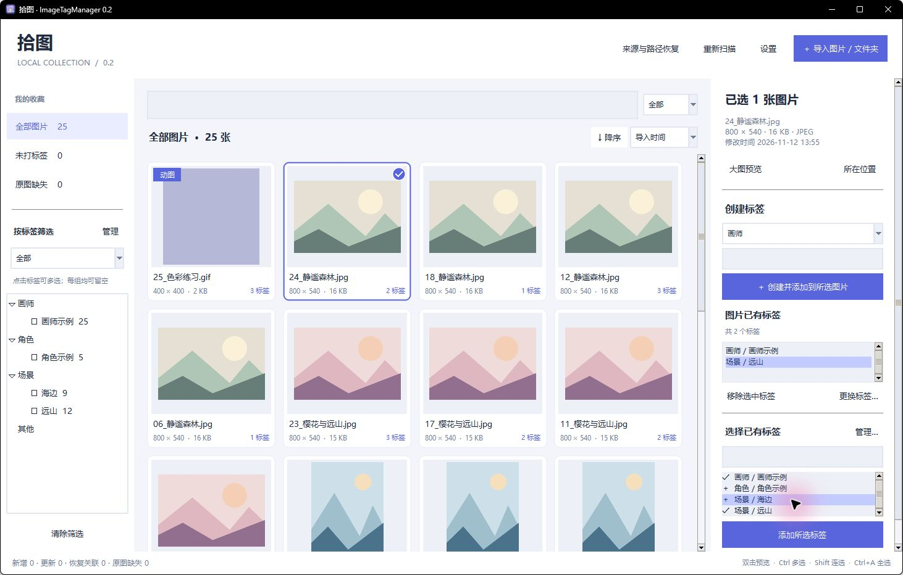
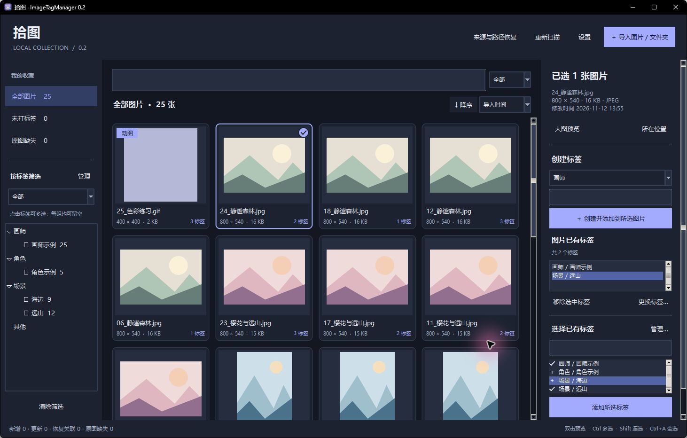
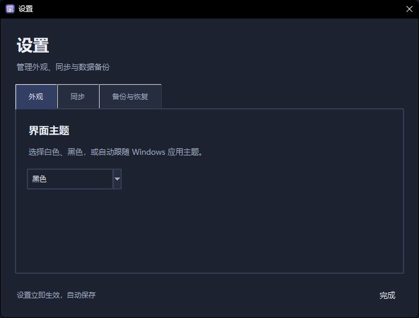
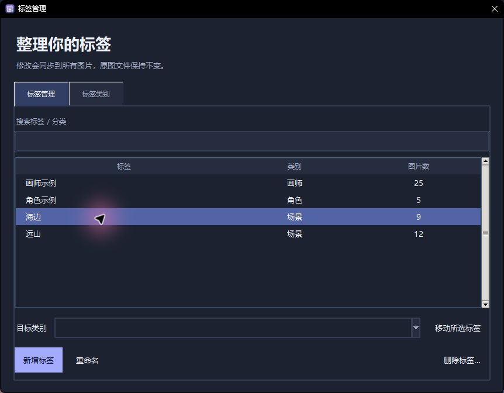
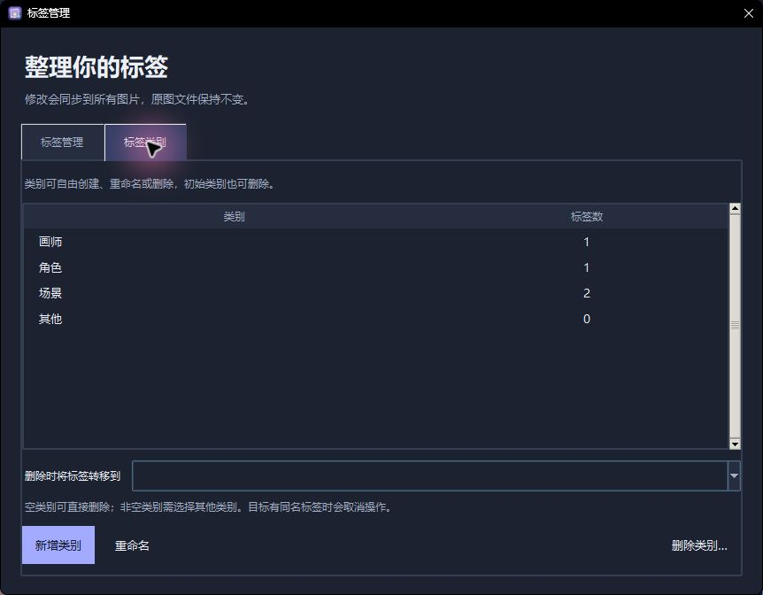

# Version 0.2 updates

- Original anime-style application icon for the EXE, windows and taskbar. The executable is directly inside `V0.2`.
- A single Settings window groups Appearance, Sync, and Backup/Restore. Theme and automatic-sync preferences persist across restarts; Follow system detects Windows app-theme changes.
- Clearer blue-violet tag selection in both themes. Filter options are now **全部** (All) and **任一** (Any).
- Mouse-wheel input never changes combobox values; click to choose. Keyboard navigation remains available.
- Rounded image cards, antialiased selection badges, and smooth 180ms hover growth/shrink, including animated image playback.
- Inspector order: create a tag, view tags attached to selected images, then choose existing tags. Multi-selection shows tag ownership counts and supports bulk removal.
- Tag Manager supports search, bulk category moves, global deletion, renaming, and tag creation. Its Categories tab supports custom categories and deletion of the initial defaults.
- Nonempty categories require a destination before deletion. Conflicting tag names cancel the entire move. Removed default categories stay removed after restart.

# Shitu · ImageTagManager

**Version 0.2 · Windows x64 · Fully offline**

[中文](README.md) | [English](README.en.md)

A local desktop application for organizing image collections with grouped tags. Reference existing folders or copy/move images into a managed library, then browse and filter the collection visually. Tags are stored separately: tagging does not modify the original image contents or filenames.

The application uses Python, Tkinter, Pillow, and SQLite. The current user interface is in Simplified Chinese; this is the English documentation.

## Download and run

1. Open this version folder's `release` directory (or the GitHub Releases page after publication).
2. Use `ImageTagManager-0.2-Windows-x64.zip`.
3. Extract the entire archive, then double-click `ImageTagManager.exe` inside the main folder.

The packaged executable includes its runtime and does not require Python or an account. The application works offline. The ZIP includes the executable, source code, build script, tests, and documentation. The repository itself contains the source and documentation; executable downloads are provided as Release assets.

The default managed library is `ImageTagManager 图片库` inside the Windows **Pictures** folder. The application asks Windows for that folder's actual location, including redirected locations. The database, thumbnail cache, and application log are stored in `%LOCALAPPDATA%\ImageTagManager`, independently of the EXE's location.

## Quick start

1. Click **导入图片 / 文件夹** (Import images/folders). Choose **复制到图片库** (Copy to library, default), **移动到图片库** (Move to library), or **保留原位置** (Keep original location).
2. Select images, or add one or more folders and click Import. Subfolders are included automatically.
3. Select thumbnails. Use Ctrl or Shift for multiple images. On the right, create a tag in a group or select existing tags and click **添加所选标签** (Add selected tags).
4. Select tags on the left. **全部** (All) requires every selected tag; **任一** (Any) requires at least one. Combine this with search and sorting.
5. Double-click an image to preview it. Export tag backups via **设置 → 备份与恢复** (Settings → Backup/Restore) regularly and keep a separate backup of your original images.

## Features

### Import and file handling

- Import multiple folders or multiple individual images. Folder scans are recursive.
- Reference files in their existing locations, or copy/move them to the managed library.
- Copy keeps the originals. Move copies and verifies the destination, records it in the catalogue, then deletes the selected source image. Non-image files and source directories are kept.
- Preserve subfolder structure when importing a folder into the library. Name collisions receive a suffix rather than overwriting an existing destination.
- Manage identical files as separate records. Duplicate-image management is not included in 0.2.
- Open an image's location in Windows Explorer.

### Tags, search, and sorting

- Default optional groups: **画师** (Artist), **角色** (Character), **场景** (Scene), and **其他** (Other). Create, rename, and delete groups; an image may have multiple tags in a group or no tags in a group.
- Create tags, reuse existing tags, and add/remove tags in bulk. Tag names are unique within each group, ignoring case.
- Replace a tag on selected images only, or globally rename a tag for every image using it. Tag merging is not included.
- Select multiple tags and switch between intersection and union filtering.
- Search by filename, tag, or both using case-insensitive substring matching. Search and tag filters can be combined.
- Sort ascending or descending by filename, modification time, resolution, file size, or import time. Resolution compares total pixels (width × height); file size compares bytes.
- Quick views for untagged images and missing originals.

### Browsing and animation

- Supported formats: JPG/JPEG, PNG, WebP, GIF, BMP, TIFF, and AVIF. Invalid, unsupported, or excessively large images rejected by the decoder are reported and skipped. TIFF previews show the first page.
- Thumbnails enlarge slightly on hover. Supported animations have a badge and play on hover, including GIF, animated WebP, and APNG.
- Large preview with fit-to-window, 1:1 view, zoom buttons, mouse-wheel zoom, drag-to-pan, previous/next navigation, and animation playback/pause.
- Visible-region gallery rendering and a bounded thumbnail cache.

| Shortcut | Action |
| --- | --- |
| Click | Select an image |
| Ctrl + click | Add/remove an image from the selection |
| Shift + click | Select a range |
| Ctrl + A in the gallery | Select all images in the current results |
| Double-click / Enter / Space in the gallery | Open a single selected image |
| Mouse wheel in preview | Zoom |
| Drag in preview | Pan |
| Left / Right in preview | Previous / next image |
| Space in preview | Play / pause animation |

## Scanning and recovering moved files

Sources are checked at startup, every 15 seconds while automatic synchronization is enabled, and when you click **重新扫描** (Rescan). Enable or disable automatic synchronization under **设置 → 同步** (Settings → Sync); this preference persists across restarts. Disabling periodic sync leaves startup checks and manual rescans available. Initial indexing creates a SHA-256 content fingerprint and a thumbnail. Subsequent scans use paths, file sizes, and modification times to decide which files need to be read again. Scanning/import runs in a background worker.

- **Renamed or moved inside monitored folders:** a unique content match restores the original record and its tags automatically.
- **An entire referenced folder moved elsewhere:** open **来源与路径恢复** (Sources and recovery), select the old source, and choose **重新定位所选文件夹** (Relocate selected folder). The new folder becomes a monitored source. The old source is kept if some records remain unresolved.
- **Scattered missing images:** choose **在指定目录查找丢失图片** (Search for missing images in a folder). Only the selected folder and its subfolders are searched. Ambiguous matches require you to choose a candidate.
- **An edited file or a manual correction:** select its old record and use **重新关联原图** (Relink original). You can explicitly allow a file with different contents to inherit the existing tags.

Missing originals keep their records, tags, and existing cached thumbnails. The original file is required for full-size preview. The default managed-library location remains fixed: recovering a library moved elsewhere adds the new location as a referenced source; later copy/move imports still use the default library.

## Backup and restore

Open **设置 → 备份与恢复** (Settings → Backup/Restore) to export JSON containing image records, paths, content fingerprints, groups, tags, and associations. **It does not include original images or thumbnails. Back up originals separately.** Theme selection is under **设置 → 外观** (Settings → Appearance); preferences take effect immediately and are saved automatically.

Restore replaces the current catalogue. The application validates the backup and its relationships first and automatically saves the current catalogue under the data directory's `backups` folder before replacing it. If originals have moved, relocate their folders or search for missing images after restoring. Rescan to rebuild thumbnails for available originals. Restoring a catalogue does not automatically move, delete, or overwrite original images.

## Run from source

Python 3.12 or newer is required. The tested build uses Python 3.14.6 and Pillow 12.1.0 on Windows 11 x64.

```powershell
python -m pip install -r requirements.txt
python main.py
```

For an isolated catalogue or test library:

```powershell
python main.py --data-dir .test-output\data --library-dir .test-output\library --no-startup-scan
```

## Build and test

```powershell
python -m pip install -r requirements-build.txt
python -m unittest discover -s tests -p test_core.py -v
python tests/smoke_ui.py
.\build.ps1
python tools/package_release.py
```

`build.ps1` runs the core and UI checks, then builds `ImageTagManager.exe` directly in the version folder with PyInstaller, including its application icon. Editable artwork and design notes are in `assets`. Dependencies are needed at build time; the resulting application runs offline. The single-file executable extracts runtime components to a temporary folder during startup.

`tools/package_release.py` creates the release ZIP and a SHA-256 checksum file under `release`, including the main project folder and EXE while excluding build caches and generated test data.

Tests use generated images only and cover failed copies/moves, source preservation, tags, filters, scanning, missing-file recovery, ambiguous matches, backup validation, and native UI flows. `tools/preview_fixture.py` opens an isolated demonstration gallery under `.test-output/visual`. See [TEST_REPORT.md](TEST_REPORT.md) for the test scope. Initial import speed for a real collection of thousands of high-resolution images has not been benchmarked, and the EXE has not been tested on other Windows computers.

## Scope and feedback

Version 0.2 does not include tag merging, duplicate-image detection, web scraping, AI tagging, cloud synchronization, or mixed nested AND/OR expressions.

Report bugs or suggestions in this repository's Issues with the version, reproduction steps, expected result, and actual result. Remove private information from any images or logs you choose to share.

## License

No source-code license has been selected for this release. Contact the repository owner for permission before redistributing the project or using its source in another project.

## 界面预览 / Interface previews

示例图片由测试脚本生成。 / Demo images are generated fixtures.






