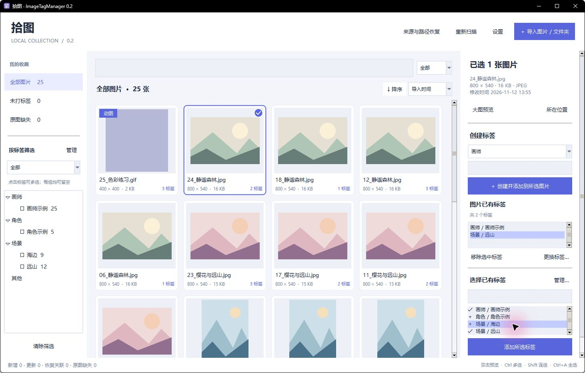
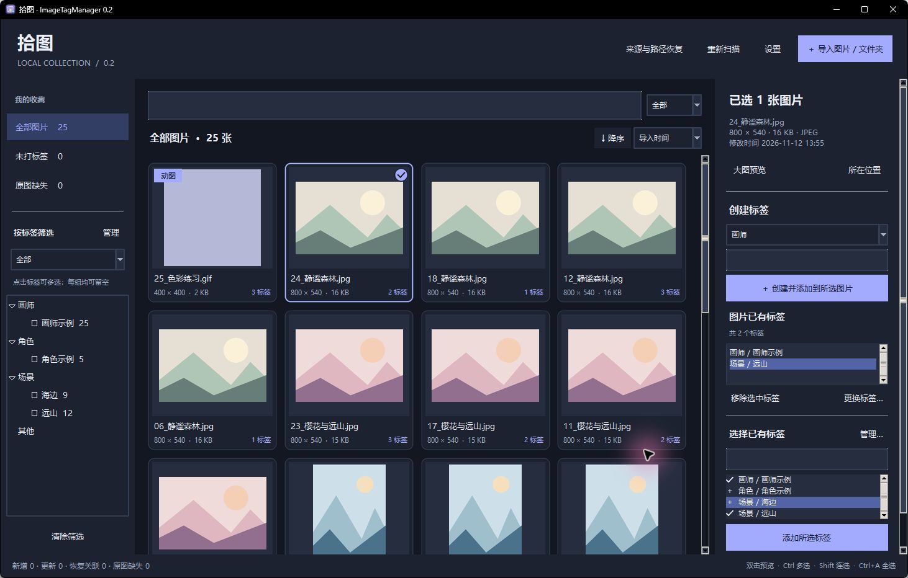
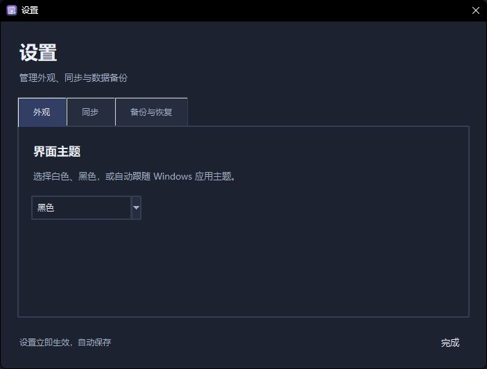
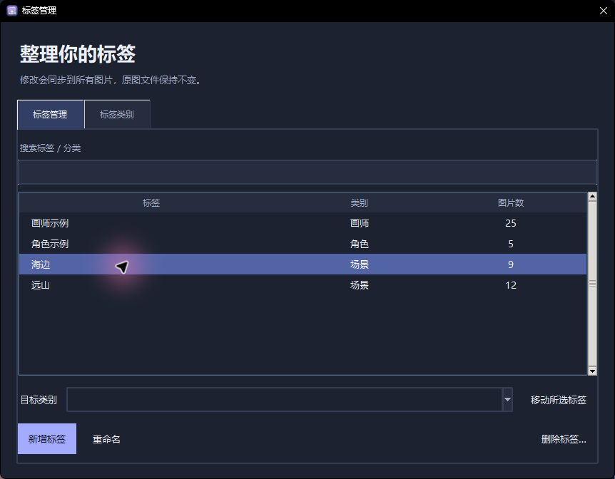
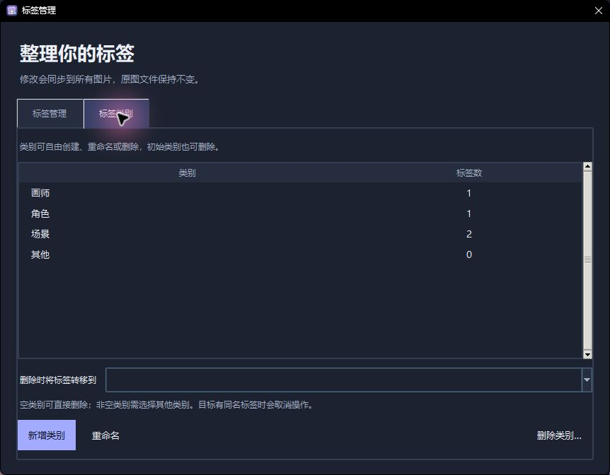

# 拾图 · ImageTagManager

**版本 0.2 · Windows x64 · 完全离线**

[中文](README.md) | [English](README.en.md)

完全离线的 Windows 图片标签管理工具。第一版基于 Python、Tkinter、Pillow 和 SQLite，原图文件不写入标签信息。

## 0.2 更新

- 原创二次元应用图标，覆盖 EXE、窗口和任务栏；EXE 直接放在 `V0.2` 文件夹下。
- 顶部“设置”集中管理外观、同步、备份与恢复；主题提供白色、黑色、跟随系统，主题及自动同步开关会记住选择。
- 标签选中行采用更清晰的蓝紫色，适配浅色与深色主题；筛选选项简化为“全部”和“任一”。
- 所有下拉栏忽略鼠标滚轮，点击展开后选择；键盘仍可用于无障碍操作。
- 缩略图使用圆角卡片与抗锯齿选中标记，悬停约 180ms 平滑放大、移开平滑缩小；动图播放保持可用。
- 右侧从上到下为创建标签、图片已有标签、选择已有标签。多选图片时已有标签显示拥有数量，可批量移除。
- 点击“管理”打开标签管理页：支持搜索、批量移动分类、删除标签、重命名、新建标签；“标签类别”页可创建、重命名、删除任意类别。
- 删除非空类别前需选择其他类别接收标签；同名冲突会取消整个移动。删除空类别后重启不会重新创建默认类别。

## 使用

从本版本文件夹下的 `release` 目录（发布后也可从 GitHub Releases）获取 `ImageTagManager-0.2-Windows-x64.zip`，先完整解压，再双击主文件夹中的 `ImageTagManager.exe`，不需要安装 Python。应用界面目前为简体中文；本文档另提供英文版。

本仓库保存源码与文档，Release 压缩包另外包含 EXE。自行构建后的程序位于本版本目录下的 `ImageTagManager.exe`。源码运行需要 Python 3.12 或更新版本：

```powershell
python -m pip install -r requirements.txt
python main.py
```

默认图片库：Windows 系统“图片”文件夹下的 `ImageTagManager 图片库`。通过系统 API 获取“图片”的实际位置，兼容系统文件夹重定向。标签数据库、缩略图缓存和日志默认位于 `%LOCALAPPDATA%\ImageTagManager`，EXE 放在哪里不会影响这些数据。程序没有联网功能。

## 快速上手

1. 点击右上角“导入图片 / 文件夹”，默认“复制到图片库”；也可以选择移动或引用原位置。
2. 选择图片，或连续添加多个文件夹后点击“导入”。等待后台扫描完成。
3. 单击缩略图选择图片；按住 Ctrl / Shift 多选。在右侧选择分组并创建标签，或选择已有标签后点击“添加所选标签”。
4. 在左侧勾选多个标签，并选择“全部”或“任一”；用上方搜索框和排序进一步查找。
5. 双击图片打开大图预览；定期通过“设置 → 备份与恢复”导出标签数据，并单独保管原图。

## 导入与浏览

- 点击“导入图片 / 文件夹”，选择复制、移动或保留原位置。默认复制，可连续添加多个文件夹或一次选择多张图片。文件夹默认递归扫描。
- 复制保留原文件；移动先复制、校验内容、保存记录，再删除源图片。不会删除源文件夹或非图片文件。已存在的同名目标文件不会被覆盖。
- 复制文件夹时，在图片库保留其子目录结构；目录重名会生成新目录。相同内容的多张文件允许同时管理，第一版没有重复图片管理功能。
- 支持 JPG/JPEG、PNG、WebP、GIF、BMP、TIFF、AVIF（损坏、无法解码或尺寸超过解码器安全限制的文件会报告错误并跳过）。TIFF 为首页预览；GIF、动态 WebP、APNG 等可显示动图角标并在悬停时播放。
- 缩略图悬停轻微放大；双击或按 Enter / 空格进入大图预览。滚轮缩放，拖动平移；支持适应窗口、1:1、上一张、下一张以及播放/暂停动图。
- 单击选择；Ctrl 多选、Shift 连选、Ctrl+A 选择当前结果中的全部图片。右侧可打开图片所在位置。

## 标签与查找

- 初始分组为画师、角色、场景、其他。分组可以创建、重命名、删除；每张图片无需填写所有分组，同一组可有多个标签。
- 在右侧下方选中已有标签后添加，在“图片已有标签”框中选中后移除，支持批量操作；也可以选择分组并创建标签。相同分组内重名会复用已有标签。
- “仅为选中图片更换标签”只替换这些图片上的关联，不修改其他图片；“标签管理”中的重命名则影响所有使用该标签的图片。
- 左侧标签点击可多选；“全部”要求满足所有选中标签，“任一”要求满足至少一个。空标签筛选表示不过滤。
- 搜索框旁可选择全部、文件名或标签，采用不区分大小写的包含匹配。可与标签筛选叠加。
- 支持按文件名、修改时间、图片分辨率、文件大小、导入时间升序或降序排列。分辨率按像素总数（宽 × 高）比较，文件大小按字节数比较。
- “未打标签”和“原图缺失”提供快捷筛选。

## 自动同步与路径恢复

程序启动检查来源文件夹；运行期间默认每 15 秒检查一次，也可手动“重新扫描”。在“设置 → 同步”中开关自动同步，选择会保存，重新打开软件后仍然有效。关闭定期同步不影响启动检查或手动扫描。首次导入会生成 SHA-256 内容指纹与缩略图；后续根据路径、字节数、修改时间决定是否需要重新读取文件。后台串行处理导入/扫描，缩略图按可见区域加载。

1. 在已管理的目录中改名或移动：扫描发现唯一的内容匹配时，自动恢复关联并保留标签。
2. 整个引用文件夹搬家：“来源与路径恢复” → 选择原目录 → “重新定位所选文件夹”。新目录会作为后续扫描来源；原目录仍有未恢复记录时会保留原来源。
3. 零散图片搬到其他目录：“在指定目录查找丢失图片”。只查找你指定的范围，不扫描整台电脑。发现多个候选时需手动选择。
4. 内容被修改或无法匹配：选中原记录 → “重新关联原图”，可以明确允许内容不同的新文件继承旧标签。

图片暂时缺失时，标签与已有缩略图保留，大图需要原文件才能打开。图片库的默认位置固定；为搬走的图片库恢复关联时，新位置会作为引用来源，之后的复制/移动导入仍写入默认图片库。

## 备份与恢复

在顶部“设置 → 备份与恢复”中导出 JSON，包含图片记录、原路径、内容指纹、分组、标签及关联，不包含原图或缩略图。请单独保管原图。主题设置位于“设置 → 外观”；所有设置立即生效并保存。

恢复会替换当前标签库；程序先校验备份结构及关联完整性，再自动在数据目录 `backups` 下保存恢复前的数据。恢复后标签立即可用，图片已搬家则按上述步骤恢复关联；点击重新扫描可为仍存在的图片重建缓存。不会因恢复备份自动移动、删除或覆盖原图。

## 开发与打包

```powershell
python -m pip install -r requirements-build.txt
python -m unittest discover -s tests -p test_core.py -v
python tests/smoke_ui.py
.\build.ps1
python tools/package_release.py
```

`build.ps1` 先执行核心与界面测试，再直接在版本目录生成一个包含解释器、依赖与图标的 Windows EXE。图标原图与制作说明位于 `assets` 目录。构建时需要依赖包，生成的程序离线运行。单文件版每次启动会先在系统临时目录释放运行组件。

`tools/package_release.py` 将主文件夹所需内容与 EXE 打包到 `release` 目录，排除构建缓存和测试生成数据，并生成 SHA-256 校验文件。

测试仅使用临时生成的图片，覆盖复制/移动异常、后台扫描、批量标签、交并集、路径恢复、多候选、备份恢复和原生界面流程。`tools/preview_fixture.py` 可打开隔离的演示图库，数据仅写入项目 `.test-output/visual`。

测试或多图库隔离运行可指定：

```powershell
python main.py --data-dir .test-output\data --library-dir .test-output\library --no-startup-scan
```

第一版范围不包含标签合并、重复图片识别、联网抓取、AI 自动标签、云同步和复杂分组逻辑表达式。

## 反馈

请在本仓库 Issues 中提交问题或建议，附上版本号、复现步骤、预期与实际结果。需要提供图片或日志时，请先移除不希望公开的内容。

## 版本与许可

当前版本：0.2。功能与已知限制见本文，验证范围见 [TEST_REPORT.md](TEST_REPORT.md)。本版本尚未指定源码许可协议；如需再分发或将源码用于其他项目，请先联系仓库作者确认授权。

## 界面预览 / Interface previews

示例图片由测试脚本生成。 / Demo images are generated fixtures.






