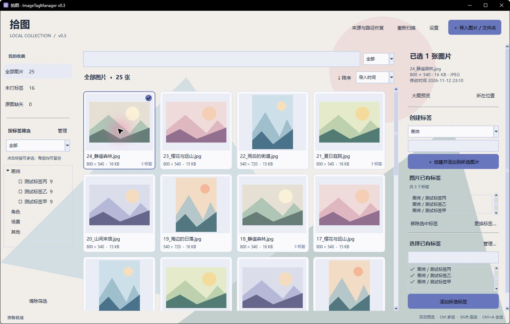
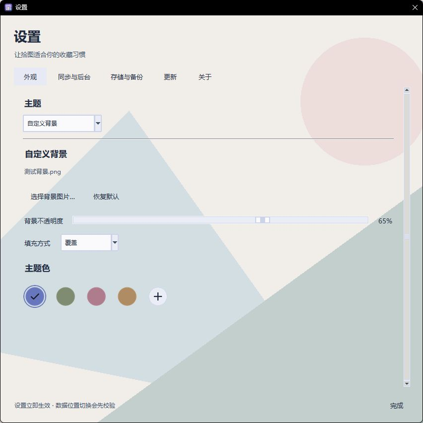

# Shitu · ImageTagManager

**v0.3.4 · Windows x64 · Offline collection management, optional online updates**

[中文](README.md) | [English](README.en.md)

A portable local image manager built with Python, Tkinter, Pillow and SQLite. Tags are stored separately; original files and names remain unchanged.

## New in v0.3.4: removal and recovery

- Single/batch image removal from the gallery or context menu, preserving originals.
- Removed view with tag-preserving restore, manual record deletion and optional 3/7/15/30-day cleanup (disabled by default).
- Folder management separates pausing sync from removing folder contents; supports subfolders, overlapping sources and optional sync on restore.
- Scan exclusions survive record deletion, backups, migration and updates; legacy databases receive a safety snapshot before migration.
- See [removal, recovery and update instructions](docs/REMOVAL.md).

## Start

Extract the complete `ImageTagManager-0.3.4-Windows-x64.zip` and run `ImageTagManager.exe` in its main folder. Python is not required. The application UI is Simplified Chinese.

Alternatively, use `ImageTagManager-0.3.4-Windows-x64-Setup.exe` for destination selection and shortcuts. Both packages use the same executable. Install into the existing application folder to upgrade, preserving `portable.json`, `data` and the image library. Uninstall retains user data. See [installation and upgrade instructions](docs/INSTALLATION.md), including the existing GitHub rate-limit limitation.

On first launch, choose the image library location. Cancel exits without creating an empty catalogue. Copied/moved imports go to this library; referenced imports stay in place. Application data defaults to the adjacent `data` folder. `portable.json` records the data and library locations and must be kept when moving the program. Custom data locations are absolute paths.

If v0.2 data is found in `%LOCALAPPDATA%\ImageTagManager`, startup offers verified migration and inherits the existing library. The original data folder is retained. An unavailable configured data folder never silently becomes a new empty catalogue. Users of v0.2 must download v0.3 manually once.

## Features

- Faster theme-color and settings-tab switching with local refreshes, cached backgrounds, lightweight selection transitions and coalesced settings saves. See [switching measurements](docs/SWITCHING_PERFORMANCE.md) for the test scope and results (Chinese).
- Import images or multiple folders, including subfolders, by reference, copy or verified move.
- JPG/JPEG, PNG, WebP, GIF, BMP, TIFF and AVIF; animated badges and hover playback where supported by the decoder.
- Smooth thumbnail zoom, virtualized gallery, large preview, zoom/pan, 1:1 and animated playback.
- Custom tag categories, tag creation/reuse, batch tagging/removal, global rename and category moves.
- Multi-tag All/Any filtering; filename/tag search; sorting by filename, modification time, pixel area, file size or import time.
- Missing-file tracking, content-based path recovery, folder relocation and JSON tag backup/restore.
- Synchronization at 15/30 seconds, 1/5/10 minutes, or a custom 15-second to 24-hour interval. Default: one minute. Scans never overlap. The last synchronization time is shown.
- Configurable data storage with verified migration; library location persists across updates.
- One v0.3 instance per Windows login session. Reopening shows a notice and activates the running window.
- Close-to-tray prompt, remembered preference, tray restore/exit and background synchronization.
- Settings: Appearance, Sync & Background, Storage & Backup, Updates, About.
- Light, Dark and Custom Background themes cover the window and settings dialogs, with live previews and theme colors. Acrylic has been removed; text uses native rendering. Legacy material preferences are ignored while tags and library records remain intact.
- Background layouts: Cover (crop), Fit (letterbox), Center (original pixels), Stretch and Free. Free offers scale and horizontal/vertical offsets. Background layout and opacity changes preview live and persist across restarts and data migration.
- Ordinary buttons, labels and inactive navigation/settings tabs have transparent backgrounds. Only Import Images/Folders, Create and Apply, and Apply Selected Tags keep a theme-color fill; persistent selections are highlighted, with subtle hover feedback.
- Custom backgrounds flow across the main window and settings with one shared readability veil instead of local white patches. Tag areas preserve native selection, scrolling and keyboard controls. Circular swatches have no rectangular mats; batched theme changes reduce white flashes.
- All three themes support a theme color. Four circular image-derived swatches and a circular + open custom hex/color-picker/eyedropper options. Custom colors preview immediately and save only with Apply color; closing or Escape restores the previous color. Suggested swatches still apply directly. Suggestions use image quantization and perceptual separation rather than exact Material HCT.
- The sync dropdown contains only five presets. Typing a custom integer and choosing seconds/minutes clears the preset and automatically applies valid values; incomplete or invalid input retains the last valid interval.
- GitHub update checks, optional startup check (off by default), in-app notification, verified download and restart-to-update.
- About page with GitHub, Issues, email and a copyable version/system summary.

## Data safety and updates

Use Storage & Backup to migrate to an empty folder or open an existing catalogue. Migration uses the SQLite backup API, preserves committed WAL data, validates records/settings and retains the original folder. Changing the image library does not move existing images; the former library remains a referenced source. Data and image-library folders must be separate.

JSON backups include image paths, tags, groups and associations, but not original images, cached thumbnails or appearance preferences. Restore automatically backs up current records first. Keep a separate backup of original images.

Update checks use official releases from `2601079750/ImageTagManager`. Automatic checks are limited to once per hour; manual checks remain available. No images, tags or local paths are uploaded. Release notes for the current version are available offline.

The downloaded ZIP is SHA-256 checked. Only the runtime EXE is extracted; the package cannot overwrite `portable.json` or `data`. Before replacing the executable, a verified database snapshot is created. A helper waits for the old process to exit, preserves a rollback copy, replaces the EXE and starts it with a data-health handshake. If startup cannot confirm the original data/library locations and image/tag associations, the previous EXE and database are restored. Failed startup data is retained separately. SHA-256 verifies integrity and is not a code signature.

Portable updates replace the executable only. Download the full release ZIP when you also need updated source and documentation. Keep `portable.json` and `data` with the application. Do not move storage or interrupt the helper while updating.

## Build

Run inside `V0.3.4` with Python 3.12+:

```powershell
python -m pip install -r requirements-build.txt
python main.py
./build.ps1
python tools/package_release.py
python tools/package_installer.py --iscc "C:\path\to\Inno Setup 7\ISCC.exe"
```

The EXE is generated directly in the version folder; the ZIP and checksum are in `release`. User databases, collections, local configuration, Git and generated test files are excluded. CLI options include `--data-dir`, `--library-dir`, and `--no-startup-scan`.

## Feedback

GitHub: https://github.com/2601079750/ImageTagManager  
Email: yh.gao0520@qq.com

## Screenshots




