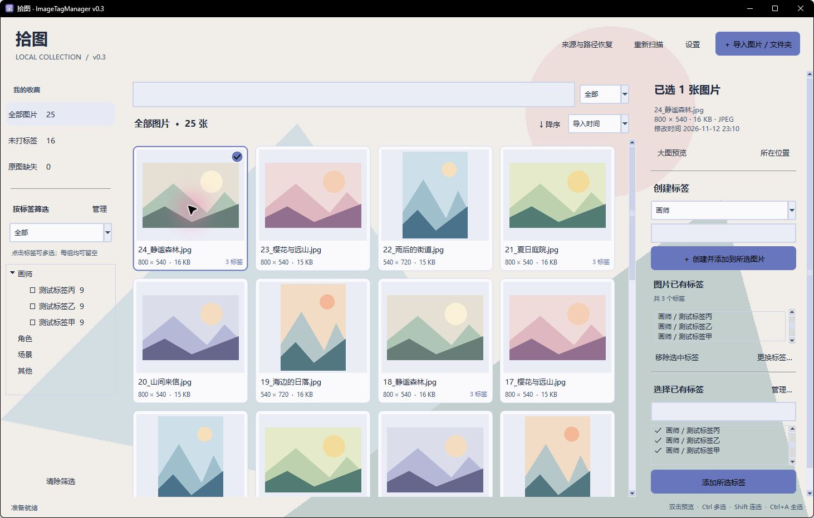
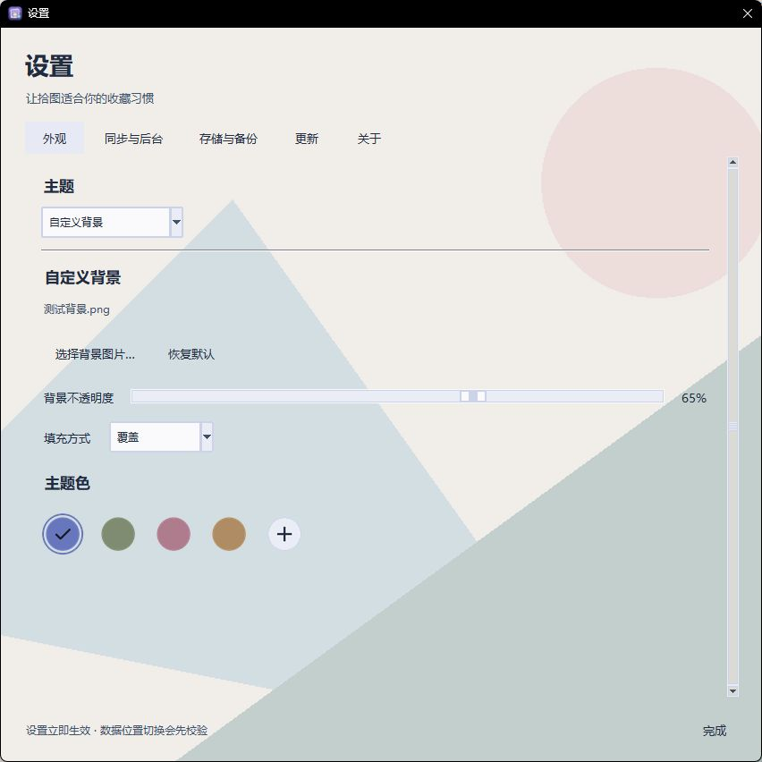

# 拾图 · ImageTagManager

**版本 v0.3.4 · Windows x64 · 图库离线使用，更新可选联网**

[中文](README.md) | [English](README.en.md)

用分组标签整理本地图片收藏。基于 Python、Tkinter、Pillow 和 SQLite，不改动原图或文件名。

## v0.3.4 新增：移除与恢复

- 图片单张 / 批量移除，图库按钮及右键入口，磁盘原图保留。
- “已移除”页面支持恢复原有标签、手动删除记录，以及 3 / 7 / 15 / 30 天自动删除记录（默认关闭）。
- 文件夹管理区分停止同步与移除目录内容，支持子目录及父子来源重叠，恢复时可选择是否同步。
- 删除移除记录后保留扫描排除规则，避免同步重新导入；备份与更新保留这些规则及尚未清理的标签关联。
- 旧数据库升级前保存安全副本，兼容旧版 JSON 备份。详细用法和升级说明见 [移除与恢复](docs/REMOVAL.md)。

## 运行与首次设置

完整解压 `ImageTagManager-0.3.4-Windows-x64.zip`，双击主文件夹中的 `ImageTagManager.exe`，无需安装 Python。首次启动必须选择图片库位置；取消则退出，不会创建空数据库。

也可下载 `ImageTagManager-0.3.4-Windows-x64-Setup.exe` 使用安装向导，选择目录并创建快捷方式。安装版与解压版使用相同程序；已有用户请在原程序目录覆盖安装，保留 `portable.json`、`data` 与图片库。卸载保留用户数据。完整说明及已知更新限流问题见 [安装与升级](docs/INSTALLATION.md)。

- 图片库：存放复制或移动导入的原图；引用导入保留原位置。
- 应用数据：默认程序旁 `data`，保存数据库、标签、设置、缓存、日志、备份和背景图。
- 程序旁的 `portable.json` 记录数据和图片库位置。移动程序时请同时保留它和 `data`；自定义数据路径按绝对路径记录。
- 首次运行 v0.3 时，如发现旧版 `%LOCALAPPDATA%\ImageTagManager` 数据，会提示迁移、校验记录与标签关联，并沿用原图片库。旧数据目录保留。v0.2 用户需要手动下载一次 v0.3。
- 已配置数据目录失效时会要求重新连接，不会静默创建空库。数据库损坏或不兼容时停止启动。

## v0.3 新增

- 主题色与设置页签局部刷新并复用背景缓存；选中态轻量过渡，外观即时预览、合并保存。实测与验证范围见 [切换性能记录](docs/SWITCHING_PERFORMANCE.md)。
- 同步间隔 15 秒、30 秒、1 分钟、5 分钟、10 分钟、自定义（15 秒至 24 小时），默认 1 分钟；托盘中继续同步，显示最近同步时间。
- 数据目录迁移和打开已有数据，完整备份与校验后切换；图片库位置可配置并跨更新保存。
- 同一 Windows 登录会话只运行一个 v0.3 实例，重复打开会提示并唤回窗口。兼容旧版对当前数据库的互斥锁。
- 关闭时默认询问是否隐藏到托盘；支持不再提醒，设置可修改关闭行为；托盘菜单恢复或退出。
- 设置五页：外观、同步与后台、存储与备份、更新、关于。
- 浅色、深色、自定义背景三个独立主题，作用于整窗及设置窗口，支持实时预览与主题色。已移除 Acrylic 磨砂效果，文字统一采用原生绘制；旧版材质设置会被忽略，标签和图片库继续保留。
- 自定义背景可选覆盖（保持比例裁切）、填充（完整显示并留边）、居中（原始像素大小）、拉伸、自由。自由模式提供缩放和水平/垂直位置；背景布局与不透明度实时预览并保存。
- 普通按钮、标题、说明及未选中的导航/设置页签使用透明底；仅“导入图片/文件夹”“创建并添加到所选图片”“添加所选标签”三个主操作常驻主题色底，选中项高亮，悬停轻量反馈。
- 自定义背景贯穿主窗口与设置窗口，共用一层保证文字对比度的半透明衬底，避免局部白块；三个标签区域保留原生选择、键盘与滚动操作。主题色圆圈无矩形底板，主题切换合并刷新，减少闪白。
- 三种主题都能选择主题色：四个圆形图片推荐色与圆形“+”自定义入口，支持色值、颜色选择器和屏幕取色。自定义窗口选色后立即预览，点击“应用颜色”才保存；关闭或按 Esc 恢复打开前的颜色。四个推荐色保留原有直接应用方式。推荐色使用图片颜色提取与感知色差，并非 Material HCT 的逐项复现。
- 检查间隔下拉只列五个预设；在“自定义间隔：”输入整数并选择秒/分钟，即清空预设框并自动应用有效间隔。无效或未完成的输入保留上次有效值，不弹窗打断输入。
- GitHub 手动检查、可选启动检查（默认关闭）、窗口左下角气泡、下载校验、重启更新与回滚副本。
- 关于页提供项目主页、Issue、邮箱及系统信息复制。窗口版本显示为 `v0.3.4`。

## 快速上手

1. 点击右上角“导入图片 / 文件夹”，默认“复制到图片库”；也可以选择移动或引用原位置。
2. 选择图片，或连续添加多个文件夹后点击“导入”。等待后台扫描完成。
3. 单击缩略图选择图片；按住 Ctrl / Shift 多选。在右侧选择分组并创建标签，或选择已有标签后点击“添加所选标签”。
4. 在左侧勾选多个标签，并选择“全部”或“任一”；用上方搜索框和排序进一步查找。
5. 双击图片打开大图预览；定期通过“设置 → 存储与备份”导出标签数据，并单独保管原图。

## 导入与浏览

- 点击“导入图片 / 文件夹”，选择复制、移动或保留原位置。默认复制，可连续添加多个文件夹或一次选择多张图片。文件夹默认递归扫描。
- 复制保留原文件；移动先复制、校验内容、保存记录，再删除源图片。不会删除源文件夹或非图片文件。已存在的同名目标文件不会被覆盖。
- 复制文件夹时，在图片库保留其子目录结构；目录重名会生成新目录。相同内容的多张文件允许同时管理，第一版没有重复图片管理功能。
- 支持 JPG/JPEG、PNG、WebP、GIF、BMP、TIFF、AVIF（损坏、无法解码或尺寸超过解码器安全限制的文件会报告错误并跳过）。TIFF 为首页预览；GIF、动态 WebP、APNG 等可显示动图角标并在悬停时播放。
- 缩略图悬停轻微放大；双击或按 Enter / 空格进入大图预览。滚轮缩放，拖动平移；支持适应窗口、1:1、上一张、下一张以及播放/暂停动图。
- 单击选择；Ctrl 多选、Shift 连选、Ctrl+A 选择当前结果中的全部图片。右侧可打开图片所在位置。

## 标签与查找

- 初始分组为画师、角色、场景、其他。分组可以创建、重命名、删除；每张图片无需填写所有分组，同一组可有多个标签。
- 在右侧下方选中已有标签后添加，在“图片已有标签”框中选中后移除，支持批量操作；也可以选择分组并创建标签。相同分组内重名会复用已有标签。
- “仅为选中图片更换标签”只替换这些图片上的关联，不修改其他图片；“标签管理”中的重命名则影响所有使用该标签的图片。
- 左侧标签点击可多选；“全部”要求满足所有选中标签，“任一”要求满足至少一个。空标签筛选表示不过滤。
- 搜索框旁可选择全部、文件名或标签，采用不区分大小写的包含匹配。可与标签筛选叠加。
- 支持按文件名、修改时间、图片分辨率、文件大小、导入时间升序或降序排列。分辨率按像素总数（宽 × 高）比较，文件大小按字节数比较。
- “未打标签”和“原图缺失”提供快捷筛选。

## 同步与路径恢复

启动、手动扫描以及可选的定时扫描会检查已管理的目录。间隔修改立即生效，正在扫描时不会叠加任务。标签记录在图片缺失时仍保留；可在“文件夹与路径管理”重新定位整个目录或查找丢失图片。唯一内容匹配时自动恢复，多个候选需选择，也可手动重新关联原图。

## 存储、备份与更新安全

“设置 → 存储与备份”可迁移到空目录或使用已有数据库。迁移使用 SQLite 在线备份接口，包含已提交的 WAL 内容，校验图片、标签、关联和设置，旧目录保留。图片库更改只影响后续复制/移动导入，旧目录保留为引用来源，不自动搬动原图。应用数据目录与图片库必须彼此独立。

JSON 标签备份包括记录、分组和路径，不含原图、缓存和外观设置；恢复前自动备份。完整迁移则保留设置和背景。请单独备份原图。

“设置 → 更新”从本项目 GitHub Releases 检查正式 Windows x64 版本。自动检查默认关闭，开启后每小时最多自动请求一次；可随时手动检查。联网只发送通常的版本请求，不上传图片、标签数据库或本地路径。当前版本更新日志可离线查看。

下载后的 ZIP 先做 SHA-256 校验，只提取主 EXE，不从下载包覆盖 `portable.json` 或 `data`。更新前保存数据库快照；辅助程序等待退出，替换 EXE，保留程序旁 `rollback`，重新打开后确认原数据目录、图片库和所有图片/标签关联一致。新版不能完成读取确认则恢复旧 EXE 和对应数据库，失败启动数据另行保留。SHA-256 用于完整性检查，不等于代码签名。不要同时移动数据目录或强制结束更新辅助程序。

便携更新只更换运行 EXE；需要对应源码时请下载完整 Release ZIP。开发目录持续保留每个版本文件夹。

## 开发与打包

在 `V0.3.4` 目录运行（Python 3.12+）：

```powershell
python -m pip install -r requirements-build.txt
python main.py
./build.ps1
python tools/package_release.py
python tools/package_installer.py --iscc "C:\path\to\Inno Setup 7\ISCC.exe"
```

源码也支持 `--data-dir`、`--library-dir`、`--no-startup-scan`；指定位置会记录到本版本旁的 `portable.json`。构建 EXE 位于版本目录一级，ZIP 与 SHA-256 位于 `release`。发布包排除用户数据、配置、图片收藏、Git 和测试生成目录。

## 反馈

GitHub：https://github.com/2601079750/ImageTagManager  
邮箱：yh.gao0520@qq.com

## 界面示例




